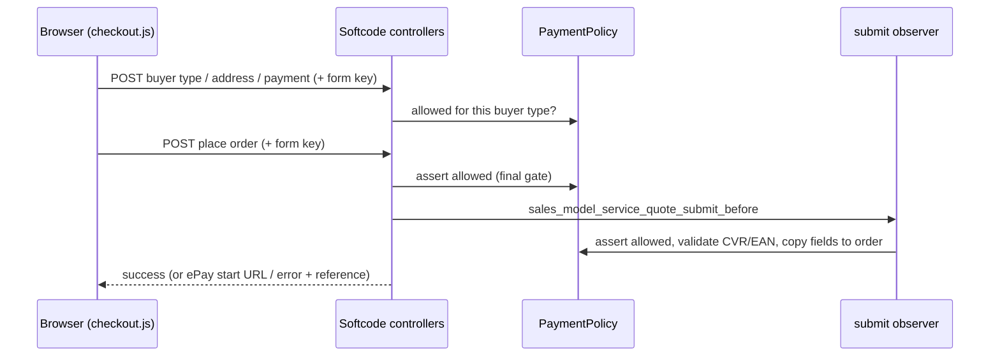

# Softcode_CheckoutOverride – one-page B2B/B2C checkout for Magento 2

[](https://github.com/DritonCa/softcode-magento2-checkout-override/actions/workflows/ci.yml)
[](LICENSE)

Replaces the default Magento checkout with a server-driven **one-page checkout** for
shops that sell to private buyers, companies (CVR) and the public sector (EAN), each
with its own allowed payment methods. Optional ePay (Bambora) payment window.

The frontend is a small **reference implementation**; the value is the server side –
one payment policy, CSRF-validated endpoints and clean extension points – which you
build your own UI on top of.

## Features

- **Buyer types** – private (`privat`), company (`cvr`) and public sector (`ean`) with
  CVR/EAN required where relevant; EAN numbers are checked to be 13 digits.
- **Payment rules per buyer type** – set in the admin, enforced by the controllers *and*
  the order-submit observer (one source of truth). No rules = every available method.
- **Alternative delivery address** – company and receiver ("Att.") go into the shipping
  address, so shipping modules and ERPs get a normal Magento address.
- **Newsletter opt-in** in the checkout (never blocks the order if it fails).
- **Error references** – a failed order is logged with a short reference that the
  customer sees, so support can find the exact log line.
- **Reply-To for order emails** – send from your mail host's address, let customers
  reply to yours.
- **"Payment failed" email suppressed** (configurable) – bots abuse it to deliver
  injected template text; failed payments are logged instead.
- **Minicart stays in sync** (`sections.xml`), optional **skip cart page**.
- Optional order confirmation template with item rows (`Softcode order confirmation`).

## Requirements

| | Supported |
|---|---|
| Magento Open Source / Adobe Commerce | 2.4.6 – 2.4.8 |
| PHP | 8.1 – 8.4 |
| Optional | `epay/payment` for the ePay window, [Softcode_Gls](https://github.com/DritonCa/softcode-magento2-gls) for delivery |

Tested by installation, `setup:upgrade` and `setup:di:compile` on Magento 2.4.6-p3 with
PHP 8.2; 2.4.7 and 2.4.8 are covered by the Composer constraints but not yet verified
on a live shop.

## Installation

```bash
composer config repositories.softcode-checkout vcs https://github.com/DritonCa/softcode-magento2-checkout-override
composer require softcode/module-checkout-override:^2.0
bin/magento module:enable Softcode_CheckoutOverride
bin/magento setup:upgrade
bin/magento setup:di:compile
bin/magento cache:flush
```

## Configuration

**Stores → Configuration → Sales → Softcode Checkout**

| Group | Setting | Notes |
|---|---|---|
| General | Skip Cart Page | `/checkout/cart` goes straight to the checkout (default Yes) |
| General | Address Country | Empty = the store's default country |
| Payment Rules | Private / Company (CVR) / Public Sector (EAN) | Allowed methods; nothing selected = all available |
| Email | Reply-To for Order Emails | Optional |
| Email | Send "Payment Failed" Email | Default No (logged instead) |

To use the module's order confirmation template, select **Softcode order confirmation**
under *Sales → Sales Emails → Order*.

Orders are placed as **guest** orders by design (fast checkout without accounts).

### Example rules

A common Danish B2B setup:

| Buyer type | Allowed payment methods |
|---|---|
| `privat` | ePay |
| `cvr` | ePay, purchase order (invoice) |
| `ean` | ePay, purchase order (invoice) |

Set these in the admin, or ship them as defaults from your own module with the
`allowedMethods` argument of `Softcode\CheckoutOverride\Model\Payment\PaymentPolicy`
(see the comment in `etc/di.xml`). Admin rules take precedence.

## Endpoints

| Method | Route | Purpose |
|---|---|---|
| `GET` | `/softcode/cart/index` | Cart items and totals |
| `POST` | `/softcode/cart/applyCoupon` | Apply / clear a discount code |
| `POST` | `/softcode/index/index` | Save buyer type and company details |
| `GET` | `/softcode/index/paymentMethods` | Available payment methods |
| `POST` | `/softcode/index/saveAddress` | Save billing + (alternative) shipping address |
| `POST` | `/softcode/index/savePayment` | Save the payment method (policy-checked) |
| `POST` | `/softcode/index/placeOrder` | Place the order (`newsletter=1` to subscribe) |
| `GET` | `/softcode/epay/config` | ePay window parameters (if ePay is installed) |

Every POST must carry Magento's `form_key`.

### Reference template field ids

`#sc-address-street|housenumber|postcode|city`, `#sc-use-alt-address`,
`#sc-alt-company|receiver|street|housenumber|postcode|city`, `#sc-newsletter`, and the
delivery mount `#sc-delivery-methods` used by shipping modules such as Softcode_Gls.

## How it works



## Testing

```bash
phpunit -c phpunit.xml.dist
```

The unit tests run without a Magento install and cover the payment policy (admin
rules, DI fallback, unrestricted defaults), the submit gate (buyer type, CVR, EAN
length, payment method, field mapping incl. alternative address) and receiver-name
splitting. The full quote → order flow is described as an integration plan and
smoke checklist in [Test/README.md](Test/README.md).

## Upgrading from 1.x

- **Payment rules moved to the admin.** 1.x hard-coded privat → ePay, cvr/ean → ePay or
  purchase order. 2.0 has no default rules (all available methods allowed). Set the rules
  in the admin, or keep the old behaviour by passing `allowedMethods` in your own `di.xml`.
- **The order email template is no longer forced.** Select "Softcode order confirmation"
  under Sales Emails if you used it.
- **Reference template ids changed** from `#sc-street` etc. to `#sc-address-street` etc.
- Requires `Magento_Newsletter` (part of every standard installation).

## Known limitations

- The frontend template/JS is a minimal reference and is not covered by browser tests;
  smoke-test the checkout after installation.
- Shipping method selection comes from your shipping module (e.g. Softcode_Gls).

## Need help?

Installation, a checkout designed for your shop, or integration with your ERP:
[SoftCode](https://softcode.dk) – Magento 2 development in Copenhagen.

## License

MIT – see [LICENSE](LICENSE).
